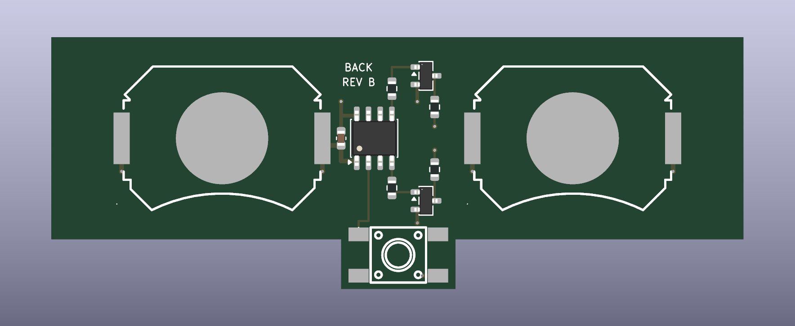
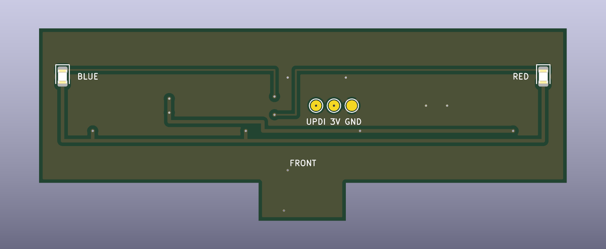
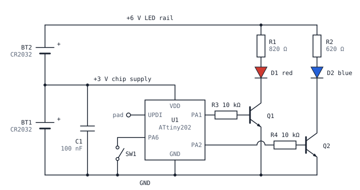

# Coin Light Board

A small circuit board that goes inside a metal challenge coin. Press the button and a red light and a blue light flash in turn, like a police light. Press again and the lights stop.

**Back side.** This side faces the back of the coin. It has the batteries, the chip, and the button.



**Front side.** This side faces the front of the coin. It has the two LEDs. Each LED sits under one light window of the coin.



## Status

**Revision B. Designed, not built.** The layout passes KiCad's design-rule check and the firmware compiles. No board has been made or tested yet.

Revision A was a first test layout. It is kept under the git tag `rev-a`.

## What it does

- Press the button: red is on for 250 ms, then blue is on for 250 ms. This repeats. That is 2 cycles each second.
- Press the button again: both lights turn off.
- After 60 seconds the lights turn off on their own. This saves the battery if a coin is left on.
- When the lights are off, the chip sleeps and uses almost no power.

## Size and fit

| | |
| --- | --- |
| Board | 75 mm long, 22 mm wide |
| Button tab | 12.4 mm wide. It goes 5.4 mm below the middle of the board. |
| Height with batteries | about 6 mm (estimate) |
| Batteries | 2 × CR2032 |
| Lights | 1 red LED and 1 blue LED, on the front side |
| Distance between the LEDs | 68.35 mm, center to center |
| Button | 6 mm × 6 mm push button, on the back side |

The board was sized for a coin that is 95.25 mm wide and 33.17 mm tall, with a metal wall of about 3 mm around the board.

**Lights.** No wires are needed. The red LED and the blue LED are on the front side of the board, 68.35 mm apart. Put the board in the coin so that each LED is under the middle of a light window. The front side is marked `RED` and `BLUE`.

**Button.** The button is on the back side, on the small tab. Its stem goes through a hole in the back of the coin. The button comes with stems of different heights. Choose the height after the thickness of the coin's back is known.

**Batteries.** Each holder has a `+` mark. Put each battery in with its `+` side up, facing away from the board.

## The circuit



**Why two batteries.** A red LED needs about 2 V. A blue LED needs about 3 V. One 3 V coin battery is not enough for the blue LED when the battery gets older. Two batteries in series give 6 V for the LEDs. The chip uses only the lower battery, so the board needs no voltage regulator.

**Why two transistors.** Each LED has its own transistor and its own resistor. A red LED and a blue LED that share one output do not both light, because the red LED holds the voltage too low for the blue one.

## Parts

| Ref | Part | Side | JLCPCB part | Note |
| --- | --- | --- | --- | --- |
| U1 | ATtiny202-SSNR, SOIC-8 | Back | C2052951 | ATtiny402, 212 and 412 fit the same pads and run the same firmware. |
| Q1, Q2 | MMBT3904, SOT-23 | Back | C20526 | |
| R3, R4 | 10 kΩ, 0603 | Back | C25804 | Confirm the part number on JLCPCB. |
| C1 | 100 nF, 0603 | Back | C14663 | Confirm the part number on JLCPCB. |
| R1 | 820 Ω, 0603 | Back | C23253 | Sets the red brightness, about 5 mA. |
| R2 | 620 Ω, 0603 | Back | C23220 | Sets the blue brightness, about 5 mA. |
| SW1 | TS-1102S-C-C-B push button, 6 × 6 × 5 mm | Back | C381039 | 5 mm tall for the test. The final height depends on the thickness of the coin's back. |
| BT1, BT2 | MY-2032-08-R CR2032 holder | Back | C964832 | |
| D1 | NCD0805R1 red LED, 0805 | Front | C84256 | |
| D2 | KT-0805B blue LED, 0805 | Front | C2293 | |

Parts are on both sides, so the order needs JLCPCB's Standard assembly service. The cheaper Economic service places one side only. [ORDERING.md](ORDERING.md) lists every choice for the order.

## Files

| File | What it is |
| --- | --- |
| `pcb/coin-light-board.kicad_pcb` | The board. Open it in KiCad 10. |
| `pcb/build_board.py` | The script that draws the board. Every part position and trace is listed in it. |
| `pcb/export.sh` | Rebuilds the board, checks it, and writes the factory files. |
| `pcb/coin-light-board-gerbers.zip` | Gerber and drill files for the bare board. |
| `pcb/jlcpcb-bom.csv`, `pcb/jlcpcb-cpl.csv` | Parts list and placement file for JLCPCB assembly. |
| `pcb/lib.pretty/` | The battery holder and button footprints, from JLCPCB's own library. |
| `ORDERING.md` | How to order test boards from JLCPCB, step by step. |
| `firmware/firmware.hex` | The compiled firmware, ready to load onto the chip. |
| `firmware/src/main.c` | The firmware, about 60 lines of C. |
| `firmware/build.sh` | Compiles the firmware in Docker. |

## Build

Firmware, with Docker running:

```sh
firmware/build.sh
```

The file for the chip is `firmware/firmware.hex`. Load it through the `UPDI`, `3V` and `GND` pads on the front side with a UPDI programmer. **Take both batteries out first.** A programmer that powers the `3V` pad would push current into the lower battery.

Board files, with KiCad 10 in `~/Applications/KiCad`:

```sh
pcb/export.sh
```

## Known gaps

- Nothing has been built. The LED resistor values come from calculation. They need tuning on a real board.
- The depth of the space inside the coin is not known yet. Thinner batteries (CR2025 or CR2016) use the same circuit if 6 mm is too much.
- The lower battery also runs the chip, so it drains a little faster than the upper one while the lights flash.
- If something holds the button down, the chip sleeps, but its pull-up resistor still draws about 0.1 mA. That would empty the lower battery in about three months.
- Nothing protects the board from a battery put in upside down.
- No trace runs under a battery on the back side. The rim of a coin cell is its `+` side, so only solder mask may sit under it.
- There is no schematic file. The circuit drawing above and `build_board.py` are the design.
- The positions and rotations in the JLCPCB placement file may need correcting in JLCPCB's preview, most of all for the two LEDs on the front side.

## License

MIT. See [LICENSE](LICENSE). The board design and the firmware are both covered.

## Made by

[Signature Coins](https://signaturecoins.com), a Stirling Marketing Group brand.
